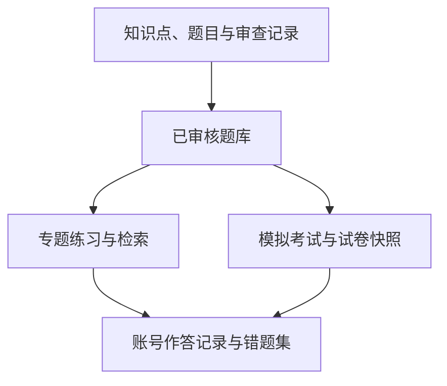

# 重庆大学入党积极分子练习

面向重庆大学入党积极分子培训复习的在线练习与模拟考试系统。题目按知识点组织，记录答案所依据的原文位置和逐项解析。练习、考试和错题记录按账号保存。

<https://cqu.xiaoweihua.cn/> · [题库与编审](#题库与编审) · [系统设计](#系统设计)

## 主要功能

| 模块 | 功能 |
| --- | --- |
| 专题练习 | 支持顺序、随机、错题和收藏模式。提交单选或多选作答后可查看答案及逐项解析。 |
| 总题库 | 中文关键词搜索题干和选项，支持组合专题、题型与作答状态筛选。 |
| 模拟考试 | 支持 **1–100 题**随机组卷，默认 50 题。考试不限时，可标记题目、续答草稿、查看交卷结果和按原题原序重考。 |
| 错题与收藏 | 考试答错或未答的题进入错题集，保留至手动移出。收藏可随时增删。 |
| 账号同步 | 邮箱验证后登录，恢复作答记录、试卷、错题、收藏和学习设置。 |

## 题库与编审

当前题库收录 **524 道通过事实与考法复审的题目**，分布在 **14 个专题**，覆盖全部 **361 个已登记的核心知识点**。题库重整期间逐题处理了 **2,115 道旧候选题**。

每道题关联知识点、原文定位、答案集合和逐项解析。事实审查复核答案依据与适用范围，考法审查复核设问和干扰项。审查记录绑定题目内容摘要，修改题干、选项、解析或依据后，须复审新版本。

[专题与校方公开范围](docs/SYLLABUS_MAP.md) · [考法证据](research/review/EXAM_STYLE_EVIDENCE.md) · [旧题处置记录](research/review/legacy-candidates.csv)

## 系统设计

界面采用 **Next.js、React 和 TypeScript**。服务端用 **PostgreSQL** 保存题库、试卷快照和账号学习记录。

- **题库版本与断网续练。** 练习分批读取和预取题目，客户端校验分片的 SHA-256 摘要。断网时可继续作答已缓存的题目，恢复网络后按账号批量补传。服务端校验题目版本，并按作答事件 ID 去重。
- **跨专题组卷与原卷重考。** 组卷按专题轮抽，排除已抽中的知识点。开考时将题序、题面、选项顺序、标准答案和解析保存为试卷快照。题库修订后，历史试卷仍按原版本展示，重考复用该快照。
- **草稿并发与交卷一致性。** 草稿带版本号，服务端拒绝过期写入。交卷在同一事务内完成判分、作答入库和错题更新。重复交卷返回已保存结果。

## 源码索引

| 路径 | 职责 |
| --- | --- |
| [内容数据](content/) · [内容校验](scripts/content/release.mjs) | 维护专题、知识点、来源、题目与审核记录，检查审核、覆盖和重复候选。 |
| [学习界面](src/features/study/) | 专题练习、题库检索、考试草稿和断网作答队列。 |
| [题库服务](src/server/content.ts) · [考试服务](src/server/exams.ts) · [学习记录](src/server/learning.ts) | 查询题库，创建与重考试卷，处理交卷及账号学习记录。 |
| [验证用例](tests/) | 题目版本审核、账号隔离、断网补传、原卷重考和重复交卷等回归场景。 |

## 许可证

项目代码采用 [MIT License](LICENSE)。

题目和解析供学习参考，考试范围以学校当期通知为准。
